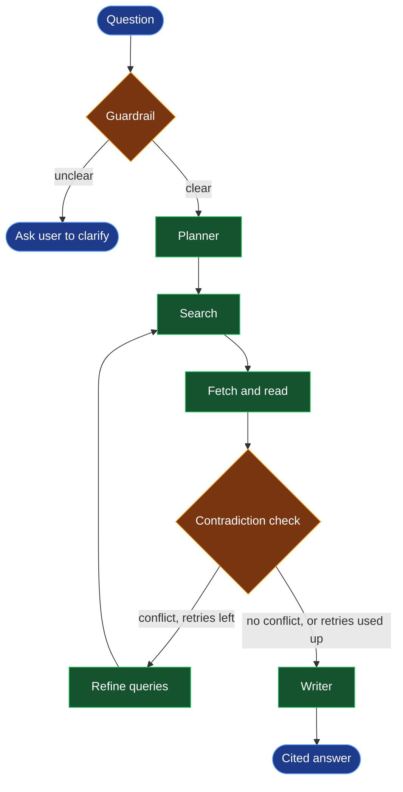

# Veritas

Veritas is a multi-agent research assistant that answers questions by searching the web, reading real source pages, and cross-verifying claims across multiple sources before writing a final answer, with every claim traced back to a numbered citation. Built with LangGraph.

## How it works



- **planner:** splits a question into 1-3 focused search queries (a simple fact stays one query)
- **search:** Tavily web search
- **fetch:** downloads pages in parallel with timeouts, skips dead or blocked links, accumulates sources across retries
- **check:** an LLM flags sources that give conflicting values or opposite answers
- **refine:** on a conflict, writes new queries aimed at the disagreement (max 2 retries)
- **writer:** answers using only the numbered sources, citing every claim as `[n]`, and states disagreements openly

## Status

- [x] Core pipeline: planner, search, fetch, contradiction check, refine loop, writer
- [x] Retry cap verified (stops after 2 retries)
- [x] Guardrail for unresolved references ("it", "they"), asks for clarification before searching
- [x] Streamlit UI with a landing page, a live pipeline graph, and clickable `[n]` citations
- [x] Faithfulness evaluation: per-claim judge, with tests on known cases

## Evaluation

`src/veritas/faithfulness.py` checks whether each claim in an answer is backed by the source it cites.

1. An LLM judge splits the answer into single-fact claims, keeping their `[n]` markers.
2. The code reads the citation numbers from the claim text itself, so the model can't invent a citation. A claim with no `[n]` is marked `uncited`.
3. The judge marks each claim `supported`, `partial` or `unsupported`, using only the cited source.
4. Score = supported claims ÷ all claims.

Tested on fixed cases with known answers (`test/test_faithfulness.py`), and with a sabotage test (`test/eval_sabotage.py`) that changes the dates in a real answer and expects the score to fall. It fell from 1.0 to 0.0.

**Limits:** the judge is an LLM, so it can be wrong. Subtle errors (a wrong month, a close number) and claims citing several sources have not been tested yet.


## Setup

```bash
uv sync
```

Create a `.env` file:

```
GEMINI_API_KEY=your-key
TAVILY_API_KEY=your-key
```

Run the graph:

```bash
uv run python test/test_graph.py
```

## Known issues

Failures found while building, with causes and fixes, are logged in [FAILURES.md](FAILURES.md).